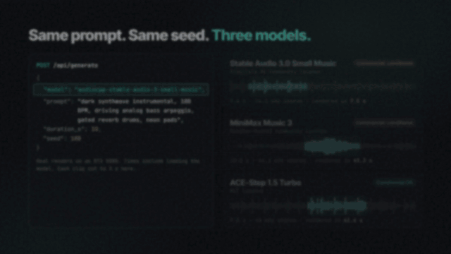

<div align="center">

# Soundbox

**The free, open-source, local alternative to ElevenLabs and Suno.**

Sound effects, music, songs with lyrics, speech and voice cloning from
open-weight models on your own GPU. Arrange it on a timeline, or let Claude
Code, Cursor or any MCP agent do it. No account, no credits, works offline. MIT.

[Download](#download) · [Hear it](#hear-it) · [For agents](#for-agents) · [Models](#models) · [Docs](#docs) · [Website](https://hamsanders.github.io/soundbox/)

[](https://github.com/HamSanders/soundbox/releases/latest)
[](https://github.com/HamSanders/soundbox/releases)
[](LICENSE)
[](docs/MCP.md)



**Watch:** [30-second tour](https://hamsanders.github.io/soundbox/media/soundbox-vibe.mp4) · [Under the hood](https://hamsanders.github.io/soundbox/media/soundbox-tech.mp4) · [Agents and MCP](https://hamsanders.github.io/soundbox/media/soundbox-agents.mp4)

</div>

## Describe it, hear it, arrange it

| Make | Arrange | Connect |
|---|---|---|
| Sound effects and ambience from a description | A multi-track timeline with effects, MIDI and mixdown | An MCP server with 24 tools for Claude Code and Cursor |
| Instrumentals, or songs from a lyric sheet | Cast saved voices onto the lines of a script | A local HTTP API on port 17494 |
| Speech, voice cloning and voice conversion | Extend, cover, repaint, split into stems | Three agent skills, including a full sound pass |

Four models are verified end to end and on by default; 61 more can be switched
on from the Models page. Each model's licence is shown before you download it.
Everything stays in one SQLite file and a folder of WAVs under `~/.soundbox`.
Profiles give you several libraries in one install, one per game or client,
switched from the header without a restart; the models are shared.

<details>
<summary><b>Screenshots</b> · studio, music, SFX, Voice Lab, models</summary>
<br>


| | |
|---|---|
|  |  |
| **Music.** A style prompt or a lyric sheet in, a shelf of takes out. | **Sound effects.** Every take kept with its prompt, model and seed. |
|  |  |
| **Voice Lab.** Clone a voice, then cast it onto script lines. | **Models.** Licence and VRAM shown before you download. |

</details>

## Download

| Platform | Installer |
|---|---|
| **Windows** 10 and 11 (x64) | [`Soundbox_x.y.z_x64-setup.exe`](https://github.com/HamSanders/soundbox/releases/latest) |
| **macOS**, Apple silicon | [`Soundbox_x.y.z_aarch64.dmg`](https://github.com/HamSanders/soundbox/releases/latest) |
| **macOS**, Intel | [`Soundbox_x.y.z_x64.dmg`](https://github.com/HamSanders/soundbox/releases/latest) |

The installer carries its own runtime. The builds are not signed yet, so the
first launch asks you to confirm ([where](docs/DESKTOP.md#installing)). Open
SFX, describe the material, the action and the space, and generate: the first
model downloads when you pick it, with its licence shown first.

| Hardware | What to expect |
|---|---|
| NVIDIA GPU (Windows, Linux) | CUDA. A few GB of VRAM covers the verified models; MiniMax Music 3 wants about 10 GB. |
| AMD or Intel GPU | Runs on the CPU unless you set `SOUNDBOX_AUDIOCPP_BACKEND=vulkan` ([how](docs/AUDIOCPP.md#choosing-a-backend)). Vulkan is not yet confirmed on the verified models; reports welcome. |
| Apple silicon | Metal. Installers exist; none of the verified models has been confirmed on a Mac yet. |
| No dedicated GPU | Works, slowly. A clip that takes seconds on a GPU takes minutes on the CPU. |

Linux, Docker and running from source are under [Run from source](#run-from-source).

### Install with a prompt

Paste this into Claude Code, Cursor or Codex:

```text
Install Soundbox on this machine and confirm it works, following
https://github.com/HamSanders/soundbox/blob/main/docs/INSTALL-AGENT.md
```

The guide tells the agent to check the GPU and VRAM first, to show you each
model's size and licence before downloading it, never to accept a
non-commercial licence for you, and to finish by generating one sound and
telling you where the WAV is.

## Hear it

Each clip was generated by Soundbox from the prompt shown. The
[samples site](https://hamsanders.github.io/soundbox/sfx/) has around 600 more.

| | Prompt | Model | |
|---|---|---|---|
| Glass | *large window pane breaking, cracking then collapsing inward with long shards falling and shattering on a wooden floor* | Stable Audio 3.0 SFX | [▶ Listen](https://hamsanders.github.io/soundbox/sfx/glass/glass-window-pane-break) |
| Ambience | *heavy thunderstorm, driving rain with rolling thunder and wind gusting through trees, outdoor, seamless loop* | Stable Audio 3.0 SFX | [▶ Listen](https://hamsanders.github.io/soundbox/sfx/rain/rain-thunderstorm-full) |
| Game | *plasma bolt firing, thick electric discharge with a downward pitch sweep and a crackling tail* | Stable Audio 3.0 SFX | [▶ Listen](https://hamsanders.github.io/soundbox/sfx/laser/laser-plasma-bolt) |
| Instrumental | *1980s synthwave arcade title theme, wide analog saw lead, gated reverb drum machine, pulsing sidechained bass, 110 BPM* | Stable Audio 3.0 Small Music | [▶ Listen](https://hamsanders.github.io/soundbox/music/neon-arcade-nights) |
| Song | *triumphant power pop victory anthem, bright electric guitars, punchy live drums, gang vocal chorus*, with a four-line lyric sheet | ACE-Step 1.5 | [▶ Listen](https://hamsanders.github.io/soundbox/music/victory-lap) |

## For agents

Start Soundbox, then add it to your client.

```bash
claude mcp add --transport http soundbox http://127.0.0.1:17494/mcp
```

Cursor and other MCP clients take `{ "type": "http", "url": "http://127.0.0.1:17494/mcp" }`.
Then ask: "add a door slam and a coin pickup to this game", "voice these three
lines as two characters", "write a 20-second loading-screen loop". The agent
gets 24 tools for sounds, speech and multi-track stories, and three skills:
`soundbox-sfx`, `soundbox-sound-pass` and `soundbox-voice-story`. Every tool,
the stdio bridge and the skills are in [docs/MCP.md](docs/MCP.md).


## Models

Every model runs through [audio.cpp](docs/AUDIOCPP.md), a native runtime, so
there is no Python to set up. Verified end to end and on by default:

| Model | Good for | Licence | Commercial use |
|---|---|---|---|
| **Stable Audio 3.0 SFX** | Sound effects, foley, ambience | Stability AI Community | ⚠️ Under $1M revenue |
| **Stable Audio 3.0 Small Music** | Instrumental music, loops | Stability AI Community | ⚠️ Under $1M revenue |
| **ACE-Step 1.5 Turbo** | Songs with lyrics; extend, cover, repaint | MIT | ✅ Yes |
| **MiniMax Music 3** | Songs with lyrics, about 10 GB VRAM | MiniMax-Music3 Community | ⚠️ Conditional |

<details>
<summary><b>61 more in the catalog</b> · 45 text-to-speech, 6 music, 2 SFX, 4 stem separation, 4 voice conversion</summary>
<br>

| Kind | Count | Includes |
|---|---|---|
| Text-to-speech | 45 | Chatterbox, Fish Audio S2 Pro, IndexTTS 2, VibeVoice, Higgs Audio v3, Qwen3-TTS, CosyVoice 3, Kokoro and more; several clone from a reference clip |
| Music | 6 | ACE-Step 1.5 Base and XL, Stable Audio 3.0 Medium, HeartMuLa, MiniMax H3 |
| Sound effects | 2 | MiDashengLM-Gen, ControlFoley |
| Stem separation | 4 | HTDemucs (4- and 6-stem), BS-RoFormer, Mel-Band RoFormer |
| Voice conversion | 4 | RVC, Seed-VC, MioCodec, MeanVC2 |

VibeVoice 1.5B, MiDashengLM-Gen, HTDemucs 6-stem and Chatterbox Turbo have also
been run end to end; the rest are marked unverified until someone reports. The
19 added in October 2026 need audio.cpp 0.9.2 or newer
(`soundbox model install audiocpp` fetches the latest).

</details>

Any model whose licence could not be established is treated as non-commercial.
This is a summary, not legal advice: read each licence before you ship what a
model made.

## Compared with a hosted service

| | Hosted (ElevenLabs, Suno and similar) | Soundbox |
|---|---|---|
| Runs on | Their GPUs | Your machine |
| Cost | Subscription or credits | Your electricity |
| Account | Required | None |
| Models | Closed, tuned, consistent | Open weights; quality varies by model |
| Output rights | Their terms of service | The licence of the model that made it, shown up front |
| Offline | No | Yes, once the weights are downloaded |
| Agents | HTTP API | HTTP API and an MCP server |
| Source | Closed | MIT |

## Run from source

<details>
<summary><b>Node, Docker and the HTTP API</b></summary>
<br>

Requires Node 22.12 or later. No Python, no CUDA toolkit.

```bash
git clone https://github.com/HamSanders/soundbox
cd soundbox
npm install
npm run dev
```

This starts the server on port 17494 and the UI on <http://localhost:5174>.
`npm run dev:mock` runs the UI with no GPU or server (see [CONTRIBUTING.md](CONTRIBUTING.md)).

**Docker.** The server and web UI run headless in one container with the
audio.cpp runtime inside. CPU by default; add the CUDA override for a GPU. Both
pull the prebuilt image from GHCR (`:latest`, `:cuda`, or a version such as
`:v0.4.0` and `:v0.4.0-cuda`).

```bash
docker compose up -d
docker compose -f docker-compose.yml -f docker-compose.cuda.yml up -d
```

To build from the checkout instead, add `-f docker-compose.build.yml`
(and `-f docker-compose.build-cuda.yml` for CUDA) and `--build`; see
[docs/INSTALL.md](docs/INSTALL.md#docker).

There is no authentication, so keep the port on localhost or behind a reverse
proxy that has some, and set `SOUNDBOX_ALLOWED_HOSTS` to the name you reach it
by. Details are in [docs/INSTALL.md](docs/INSTALL.md#docker).

**HTTP API.** Everything the app does is available on port 17494:

```bash
curl -X POST http://127.0.0.1:17494/api/generate \
  -H 'Content-Type: application/json' \
  -d '{"model":"audiocpp-stable-audio-3-sfx","prompt":"heavy wooden door slamming in a stone corridor","duration_s":3}'
```

Long jobs return an id with a server-sent event stream. Every route is in
[docs/API.md](docs/API.md).

</details>

## Docs

| If you want to | Read |
|---|---|
| Get it running, or fix a first run | [Install](docs/INSTALL.md) · [Desktop](docs/DESKTOP.md) |
| Write prompts these models answer | [Generating](docs/GENERATING.md) |
| Arrange, mix and export | [Studio](docs/STUDIO.md) · [Library](docs/LIBRARY.md) |
| Drive it from an agent or a script | [MCP](docs/MCP.md) · [HTTP API](docs/API.md) |
| Add or verify a model | [audio.cpp](docs/AUDIOCPP.md) · [Contributing](CONTRIBUTING.md) |
| Understand how the pieces fit | [Architecture](docs/ARCHITECTURE.md) |

## FAQ

**Can I sell what I make?** It depends on the model. Stable Audio is free under
$1M revenue, ACE-Step 1.5 is MIT, and models with an unestablished licence are
marked non-commercial. Each model's terms are on its card in the app.

**Do I need a GPU?** No, but CPU generation is slow. The hardware table above
says what to expect.

**Does it work on a Mac?** There are installers for Apple silicon and Intel,
and audio.cpp runs on Metal. None of the verified models has been confirmed on
a Mac yet, so reports are welcome.

**How do I remove it?** Delete the app and `~/.soundbox`. There is no account
to close and nothing was uploaded.

## Licence

Soundbox is [MIT](LICENSE). The model weights are not: each carries its own
licence, and what you can do with generated audio is governed by the licence of
the model that made it. Clone only voices you have permission to use. Soundbox
downloads weights at your direction and does not redistribute them. Example
media under `site/public/` was generated with third-party models; its
provenance is in [ASSETS.md](ASSETS.md).
