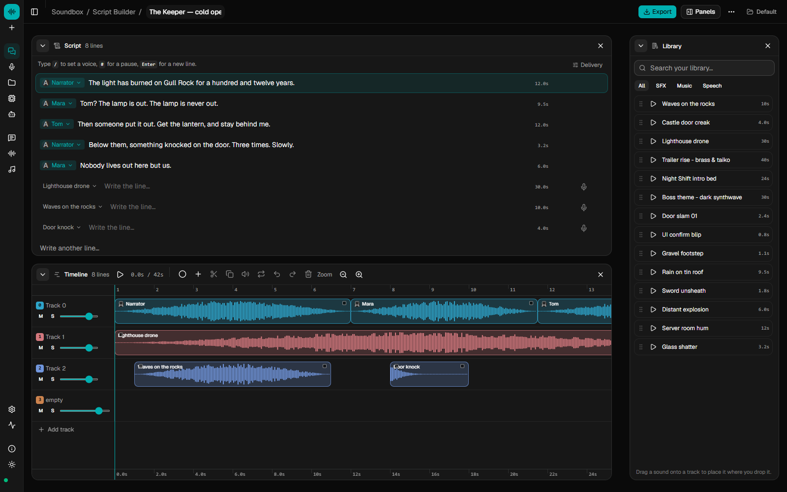
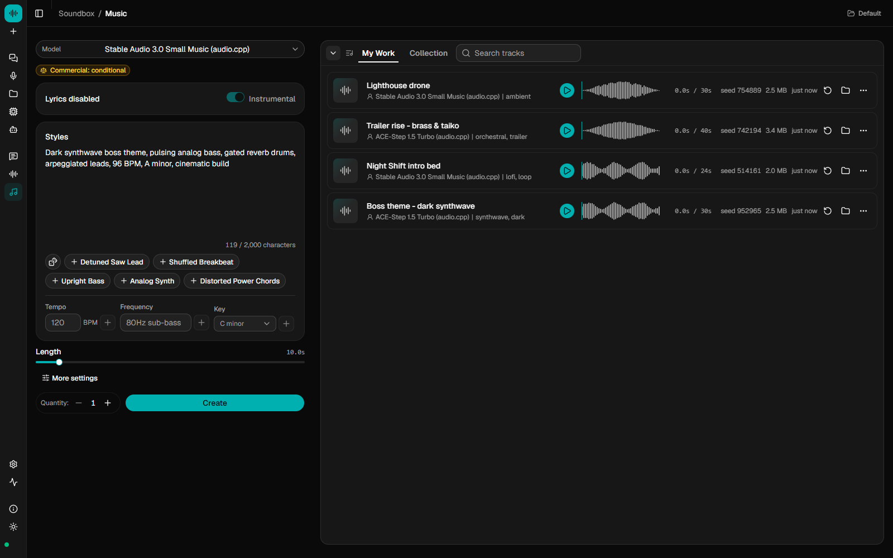
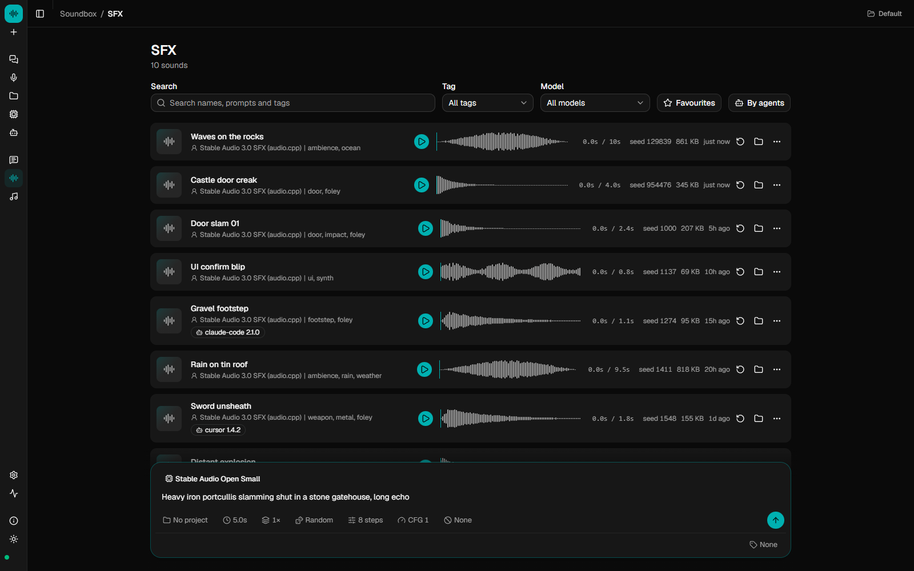
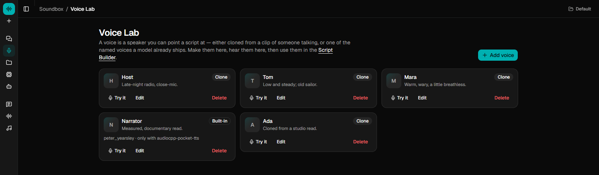
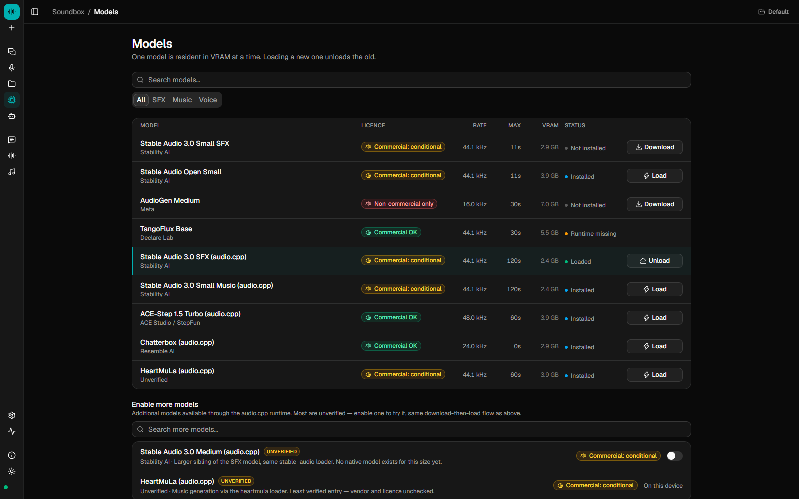
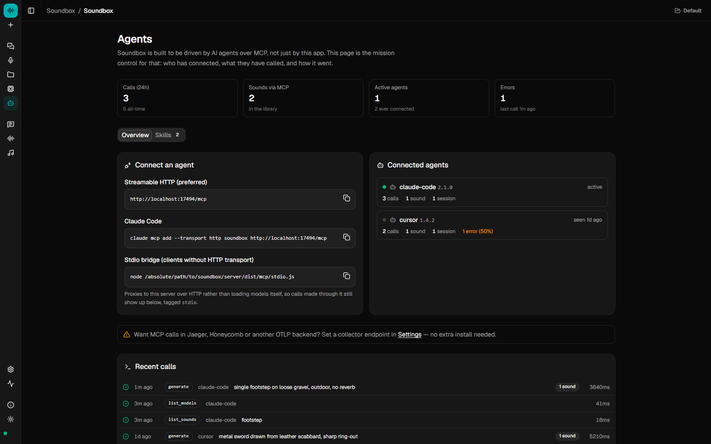

<div align="center">

# Soundbox

**Sound effects, music and voices, generated on your own machine.**

Describe a sound and get a WAV. Write lyrics and get a song. Clone a voice from a
short clip. Arrange it all on a timeline, or let your coding agent do it over MCP.
Open-weight models, no account, works offline.

[](https://github.com/Gadurp1/soundbox/releases/latest)
[](https://github.com/Gadurp1/soundbox/releases)
[](LICENSE)
[](docs/MCP.md)
[](#download)

[Download](#download) · [Hear it](#hear-it) · [Features](#features) · [For agents](#for-agents) · [Models](#models) · [Docs](docs/)



</div>

## Download

| Platform | Installer |
|---|---|
| **Windows** 10 and 11 (x64) | [`Soundbox_x.y.z_x64-setup.exe`](https://github.com/Gadurp1/soundbox/releases/latest) |
| **macOS**, Apple silicon | [`Soundbox_x.y.z_aarch64.dmg`](https://github.com/Gadurp1/soundbox/releases/latest) |
| **macOS**, Intel | [`Soundbox_x.y.z_x64.dmg`](https://github.com/Gadurp1/soundbox/releases/latest) |

The installers carry their own runtime, so nothing else needs installing.
Models download from inside the app the first time you use them. The builds
are not signed yet, so the first launch asks you to confirm:
[docs/DESKTOP.md](docs/DESKTOP.md#installing) shows where. Linux, or running
from source: see [Run from source](#run-from-source).

## Hear it

Everything below was generated by Soundbox from the prompt shown. The [samples site](https://gadurp1.github.io/soundbox/sfx/) has
around 600 more, each with its prompt, model and seed.

| | Prompt | Model | |
|---|---|---|---|
| Glass | *large window pane breaking, cracking then collapsing inward with long shards falling and shattering on a wooden floor* | Stable Audio 3.0 SFX | [Listen](https://gadurp1.github.io/soundbox/sfx/glass/glass-window-pane-break) |
| Explosion | *underwater explosion, muffled deep concussive thump with a swirling bubble surge and a pressure wave* | Stable Audio 3.0 SFX | [Listen](https://gadurp1.github.io/soundbox/sfx/explosion/explosion-underwater) |
| Footsteps | *footsteps walking on an industrial metal grate walkway, ringing hollow clangs, warehouse reverb* | Stable Audio 3.0 SFX | [Listen](https://gadurp1.github.io/soundbox/sfx/footsteps/footsteps-metal-grate) |
| Ambience | *heavy thunderstorm, driving rain with rolling thunder and wind gusting through trees, outdoor, seamless loop* | Stable Audio 3.0 SFX | [Listen](https://gadurp1.github.io/soundbox/sfx/rain/rain-thunderstorm-full) |
| Game | *plasma bolt firing, thick electric discharge with a downward pitch sweep and a crackling tail* | Stable Audio 3.0 SFX | [Listen](https://gadurp1.github.io/soundbox/sfx/laser/laser-plasma-bolt) |
| Instrumental | *1980s synthwave arcade title theme, wide analog saw lead, gated reverb drum machine, pulsing sidechained bass, 110 BPM* | Stable Audio 3.0 Small Music | [Listen](https://gadurp1.github.io/soundbox/music/neon-arcade-nights) |
| Song | *triumphant power pop victory anthem, bright electric guitars, punchy live drums, gang vocal chorus*, with a four-line lyric sheet | ACE-Step 1.5 | [Listen](https://gadurp1.github.io/soundbox/music/victory-lap) |

## Features

- **Sound effects.** Describe the material, the action and the space and get a
  clip. Duration, seed, steps, CFG and negative prompt are all exposed, and
  every generation is saved with its settings so you can regenerate or vary it.
- **Music, with or without lyrics.** Instrumentals and loops from a style
  description, or a sung song from a `[verse]` / `[chorus]` lyric sheet. Extend
  a track, cover it in a new style, repaint a section, or split it into drums,
  bass, vocals and other.
- **Speech and voices.** Text-to-speech from a script, voice cloning from a
  short clip or your microphone, and voice conversion. Saved voices live in a
  Voice Lab and are cast onto the lines of a script.
- **A studio.** A multi-track timeline with per-track effects, recording, MIDI
  input, a piano roll and one-click mixdown. A chat assistant beside it turns
  requests like "mute 1 and 3, add reverb to the vocal" into edits you confirm.
- **Built for agents.** An MCP server with 21 tools lets Claude Code, Cursor or
  any MCP client generate, speak, arrange and export audio as part of a larger
  task. An Agents page logs every call.
- **Licences before you download.** Each model's licence and commercial-use
  terms are on its card, and non-commercial weights need an explicit
  confirmation.
- **Optional local helpers.** A small local language model can rewrite vague
  prompts, write lyrics and run the studio chat, and a small image model can
  draw cover art. Both are off until you turn them on. The assistant can use
  Ollama or LM Studio instead, and artwork an Automatic1111-compatible server.
- **Local and offline.** One SQLite file and a folder of WAVs under
  `~/.soundbox`. CUDA, HIP, Metal, Vulkan or CPU, picked automatically. Nothing
  is uploaded.

<table>
  <tr>
    <td></td>
    <td></td>
  </tr>
  <tr>
    <td align="center">Music: a style prompt or a lyric sheet in, a shelf of takes out</td>
    <td align="center">Sound effects: every take kept with its prompt, model and seed</td>
  </tr>
  <tr>
    <td></td>
    <td></td>
  </tr>
  <tr>
    <td align="center">Voice Lab: clone a voice, then cast it onto script lines</td>
    <td align="center">Models: licence and VRAM shown before you download</td>
  </tr>
</table>

## For agents

Start Soundbox, then add it to your client.

**Claude Code**

```bash
claude mcp add --transport http soundbox http://127.0.0.1:17494/mcp
```

**Cursor and other MCP clients**

```json
{ "mcpServers": { "soundbox": { "type": "http", "url": "http://127.0.0.1:17494/mcp" } } }
```

Then ask for what you need: "add a door slam and a coin pickup sound to this
game", "voice these three lines as two characters", "write a 20-second
loading-screen loop". The agent gets 21 tools:

| Group | Tools | Use |
|---|---|---|
| Sound and music | `generate`, `enhance_prompt`, `separate`, `list_models`, `list_sounds`, `get_sound`, `delete_sound` | One-shot generation. `generate` waits for the WAV and returns its absolute path. `separate` splits a track into stems. |
| Speech | `speak`, `list_voices` | A single read. |
| Stories | `create_story`, `list_stories`, `get_story`, `add_lines`, `update_line`, `delete_line`, `split_line`, `speak_story`, `mix_track`, `remove_track`, `export_story`, `open_in_studio` | A multi-track arrangement the agent builds over several turns and can open in the studio for you to finish. |

Three agent skills ship with Soundbox: `soundbox-sfx` (prompting),
`soundbox-sound-pass` (read a game or app, work out every sound it needs,
generate and wire them in) and `soundbox-voice-story` (write, voice and arrange
dialogue). Install them from the Agents page or with `soundbox skills install`.
Connection details, the stdio bridge and the full tool reference are in
[docs/MCP.md](docs/MCP.md).

<p align="center">
  
</p>

## Models

Every model runs through [audio.cpp](docs/AUDIOCPP.md), a native runtime, so
there is no Python to set up. Four models are verified end to end and on by
default:

| Model | Good for | Licence | Commercial use |
|---|---|---|---|
| **Stable Audio 3.0 SFX** | Sound effects, foley, ambience | Stability AI Community | ⚠️ Under $1M revenue |
| **Stable Audio 3.0 Small Music** | Instrumental music, loops | Stability AI Community | ⚠️ Under $1M revenue |
| **ACE-Step 1.5 Turbo** | Songs with lyrics; extend, cover, repaint | MIT | ✅ Yes |
| **MiniMax Music 3** | Songs with lyrics, about 10 GB VRAM | MiniMax-Music3 Community | ⚠️ Conditional |

42 more are in the catalog and can be switched on from the Models page:

- **Text-to-speech (33):** Chatterbox, Fish Audio S2 Pro, IndexTTS 2 and 2.5,
  VibeVoice, Higgs Audio v3, Qwen3-TTS, MOSS TTS, VoxCPM 2, Supertonic 3,
  Pocket TTS and more. Several clone from a reference clip.
- **Music:** ACE-Step 1.5 Base, Stable Audio 3.0 Medium, HeartMuLa, MiniMax H3.
- **Stem separation:** HTDemucs, BS-RoFormer, Mel-Band RoFormer.
- **Voice conversion:** RVC, Seed-VC, MioCodec.

Of these, VibeVoice 1.5B has also been run end to end; the others are marked
unverified until someone reports. Several are non-commercial, and any model
whose licence could not be established is treated as non-commercial. The
table is a summary, not legal advice: read each licence before you ship what a
model made.

## Compared with a hosted service

| | Hosted (ElevenLabs, Suno and similar) | Soundbox |
|---|---|---|
| Runs on | Their GPUs | Your machine |
| Cost | Subscription or credits | Your electricity |
| Account | Required | None |
| Models | Closed, tuned, consistent | Open weights; quality varies by model |
| Output rights | Their terms of service | The licence of the model that made it, shown up front |
| Offline | No | Yes, once the weights are downloaded |
| Agents | HTTP API | HTTP API and an MCP server |
| Source | Closed | MIT |

## The studio

Pick a builder when you start a project. The **Script Builder** is for
dialogue: write lines, cast each to a voice, read them, and arrange the takes.
The **Music Builder** is for tracks and effects: describe one, generate it onto
a lane, then extend, cover, split into stems or layer more. Both share the
timeline, an eight-effect device rack, MIDI and piano roll, recording, the
library and the chat assistant. Export mixes the arrangement down to one new
sound. The full guide, with every shortcut, is [docs/STUDIO.md](docs/STUDIO.md).

## HTTP API

Everything the app does is available over a local HTTP API on port 17494.

```bash
curl -X POST http://127.0.0.1:17494/api/generate \
  -H 'Content-Type: application/json' \
  -d '{"model":"audiocpp-stable-audio-3-sfx","prompt":"heavy wooden door slamming in a stone corridor","duration_s":3}'
```

Long jobs return an id with a server-sent event stream. The server binds to
loopback and has no authentication. Every route is listed in
[docs/API.md](docs/API.md).

## Run from source

Requires Node 22.12 or later. No Python, no CUDA toolkit.

```bash
git clone https://github.com/Gadurp1/soundbox
cd soundbox
npm install
npm run dev
```

This starts the server on port 17494 and the UI on <http://localhost:5174>.
The first run walks you through picking models for your GPU.
[docs/INSTALL.md](docs/INSTALL.md) covers the command-line tool, environment
variables and troubleshooting; [docs/DESKTOP.md](docs/DESKTOP.md) covers
building the desktop app; `npm run dev:mock` runs the UI with no GPU or server
(see [CONTRIBUTING.md](CONTRIBUTING.md)).

## Docs

| | |
|---|---|
| [Install](docs/INSTALL.md) | Installing, first run, the CLI, environment variables, troubleshooting |
| [Generating](docs/GENERATING.md) | Writing prompts these models respond to, settings, stems |
| [Studio](docs/STUDIO.md) | The timeline, builders, devices, MIDI, chat and shortcuts |
| [Library](docs/LIBRARY.md) | Sessions, projects, tags and where files live |
| [MCP](docs/MCP.md) | Connecting agents and every tool |
| [HTTP API](docs/API.md) | Every route |
| [Desktop](docs/DESKTOP.md) | Installers, first launch, building, signing |
| [audio.cpp](docs/AUDIOCPP.md) | The model runtime, backends and adding a model |
| [Architecture](docs/ARCHITECTURE.md) | How the pieces fit together |

## FAQ

**Can I sell what I make?** It depends on the model. Each model's licence and
commercial terms are on its card in the app and in the table above. Stable
Audio is free under $1M revenue, ACE-Step 1.5 is MIT, and models with an
unestablished licence are marked non-commercial.

**Do I need a GPU?** No, but CPU generation is slow. A few GB of VRAM covers
the verified models, and each model card shows its footprint.

**Does it work on a Mac?** There are installers for Apple silicon and Intel,
and audio.cpp runs on Metal. None of the verified models has been confirmed on
a Mac yet, so reports are welcome.

## Contributing

Adding a model is a catalog entry, with no new code. Running a listed model and
reporting the result helps just as much, since that is how a model becomes
verified. See [CONTRIBUTING.md](CONTRIBUTING.md).

## Licence

Soundbox is [MIT](LICENSE). The model weights are not: each carries its own
licence, and what you can do with generated audio is governed by the licence of
the model that made it. Soundbox downloads weights at your direction and does
not redistribute them. The example media under `site/public/` was generated
with third-party models; its provenance is in [ASSETS.md](ASSETS.md).
