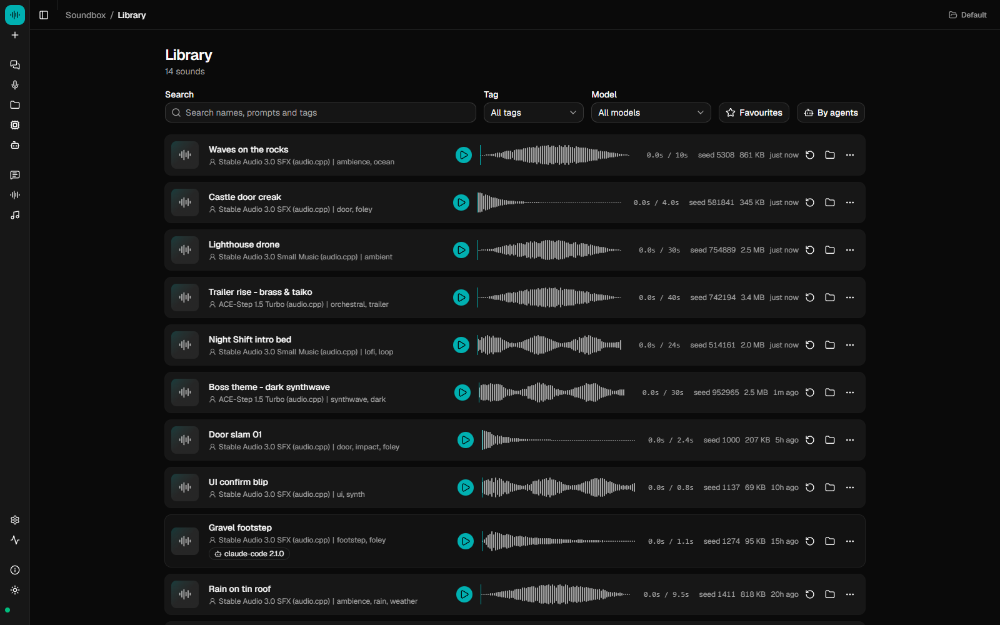

<div align="center">

# Soundbox

**Open-source AI sound effects, music and text-to-speech that run on your own machine.**

Type what you want to hear and get a WAV. Clone a voice from a few seconds of
audio. Write a song with lyrics. Arrange all of it on a timeline. Or point a
coding agent at it over MCP and let the agent do that as part of a bigger job.
No account, no API key, no per-generation bill — the models are open weights,
the app is MIT.

[Quick start](#quick-start) · [What it does](#what-it-does) · [Studio](#the-studio) · [For agents (MCP)](#for-agents) · [Models](#models) · [API](docs/API.md) · [Docs](docs/) · [Contributing](CONTRIBUTING.md)


</div>

---

If you have been paying one service for voices and another for songs, this is
the local version of both, in one app, for free — with the honest caveat that
open-weight models are not tuned to the standard a hosted product is, and the
table further down says exactly which ones have been verified on real
hardware. What you get in exchange is that nothing leaves your machine, the
licence of every model is on screen before you download it, and the output is
yours under that licence rather than under someone's terms of service.

There are excellent open-weight text-to-audio models, and every one of them
ships as a research repo: clone this, pin that CUDA wheel, write your own
inference script, discover the licence afterwards. [audio.cpp](docs/AUDIOCPP.md)
solved the hard part — one native binary that installs and runs any of them,
no Python. Soundbox is what sits on top: the interface, the library, the
timeline, the API and the agent surface. There is no Python in the inference
path at all; the server is TypeScript on Node.

## What it does

**Sound effects.** Describe the material, the action and the space — "heavy
wooden door slamming in a stone corridor" — and get a clip. Prompt, duration,
seed, steps, CFG and negative prompt are all exposed, and every generation is
saved with all of them so you can regenerate, vary or reuse it later.

**Music, with or without lyrics.** Instrumental tracks and loops from a style
description, or a song from a `[verse]`/`[chorus]` lyric sheet. Models that
support it can *extend* a track you already have, *cover* it in a new style,
or *repaint* a section. Stem separation splits any track into drums, bass,
vocals and other.

**Speech and voices.** Text-to-speech from a script. Clone a voice from a
short clip or from your microphone. Convert one voice into another. Voices
are saved to a Voice Lab and cast onto lines in a script, so a two-character
scene is a document you keep editing rather than a one-off render.

**A studio to arrange it in.** Every generation can land on a multi-track
timeline with per-track effects, MIDI input, a piano roll, recording and a
one-click mixdown. The assistant chat sits beside the timeline and can apply
edits — "mute 1 and 3, add reverb to the vocal" — as a plan you confirm.
See [The studio](#the-studio).

**An MCP server and an HTTP API.** Twenty-one MCP tools, so Claude Code,
Cursor or any MCP client can generate, speak, arrange and export as part of a
larger task, and an Agents page that shows every call every client made.
See [For agents](#for-agents).

**Licences up front.** Each model's terms are on its card before the download
button, colour-coded, and non-commercial weights need an explicit confirmation.
Some of the best models here are research-only. You should know that before
you ship a game with their output in it.

**Local and yours.** One SQLite file and one folder of WAVs under
`~/.soundbox`. Works offline once the weights are on disk. Nothing is
uploaded, because there is nowhere to upload it to.

<p align="center">
  
</p>

<p align="center">
  
</p>

## Soundbox compared with a hosted service

Not a feature-for-feature comparison — the shape of the trade is the point.

| | Hosted (ElevenLabs, Suno and the like) | Soundbox |
|---|---|---|
| Where it runs | Their GPUs | Yours. CUDA, HIP, Metal, Vulkan or CPU, picked automatically |
| What it costs | Subscription or credits per generation | Nothing. Your electricity |
| Account | Required | None. No sign-up, no key, no telemetry phoning home |
| The models | Closed, tuned, consistently good | Open weights. Quality varies by model; five are [verified](#models), the rest are opt-in |
| Who owns the output | Their terms of service | You, under the licence of whichever model made it — shown before you download |
| Offline | No | Yes, once the weights are on disk |
| Agents | HTTP API | HTTP API plus a first-class MCP server with 21 tools and per-call telemetry |
| The app | Theirs | MIT. Fork it |

## Quick start

Requires **Node 22.12+** and `git`. No Python, no torch, no GPU-specific wheel to
pick. A GPU makes generation take seconds instead of minutes, but CPU works.
The optional desktop shell (`npm run desktop`) additionally needs **Rust**
(stable, via [rustup](https://rustup.rs)) and the
[Tauri 2 OS prerequisites](https://v2.tauri.app/start/prerequisites/) — see
[Desktop app](#desktop-app).

```bash
git clone https://github.com/Gadurp1/soundbox
cd soundbox
npm install
npm run dev
```

That starts the server on `127.0.0.1:17494` and the UI on
<http://localhost:5174>, and stops both together. If the UI loads but the
Models page is empty, the server is not running — that is the whole symptom.

**First run.** The app opens a four-step setup: what you make (sound effects,
music, speech), whether it is for something you will sell, which models to
fetch — sized to your GPU, with each licence shown beside the pick — and two
optional extras, the prompt assistant and artwork, both off by default. It
downloads in the background and you can watch progress on the Models page.
Skip it and nothing is installed; Settings → Advanced → *Run setup again*
brings it back.

**Or pick models by hand.** The Models page lists everything, with a
*Download* button and the licence on each card. The same thing from the
terminal, in the `pull`/`run`/`list` shape Ollama uses for LLMs:

```bash
cd server
npx tsx src/cli.ts model install audiocpp                # the native runtime
npx tsx src/cli.ts pull audiocpp-stable-audio-3-sfx       # a model
npx tsx src/cli.ts run  audiocpp-stable-audio-3-sfx "glass breaking on concrete" --out test.wav
```

After `npm run build` the prefix becomes `node dist/cli.js` (or `npx soundbox`
from the repo root). The CLI is not on npm yet, so it runs from the checkout;
[docs/INSTALL.md](docs/INSTALL.md#running-the-soundbox-cli-from-a-clone) has
both forms.

The `audiocpp_cli` binary is fetched on demand from
[audio.cpp](https://github.com/0xShug0/audio.cpp)'s releases the first time you
ask for it and cached under `~/.soundbox/bin/` — never inside the checkout, so a
clone stays small and the build matches your machine's backend. Already have
it? Set `SOUNDBOX_AUDIOCPP_BIN` and nothing is downloaded. Paths, resolution
order and Windows notes are in [docs/INSTALL.md](docs/INSTALL.md).

**No GPU and just want to look around?** `npm run dev:mock` runs the UI
against an in-browser fake with no backend at all — models, a seeded library,
the setup wizard, the Agents page with a couple of mock clients, and audio
synthesised in the browser.

## The studio

Two builders, chosen when you make a new one, because starting from words and
starting from a prompt are different jobs:

- **Voice & dialogue** (the Script Builder) — write lines, give each a speaker
  and a voice, speak them one at a time or all at once, and arrange the reads
  on a timeline. Regenerating one mispronounced line costs seconds, not the
  whole scene.
- **Music & SFX** (the Music Builder) — describe a track or an effect, generate
  it straight onto a lane, then extend, cover, split into stems or layer more.

<p align="center">
  
</p>

Both share the same panels, each on a `Ctrl/⌘` shortcut and in a Panels menu:
a **timeline** with per-track mute, solo and gain; a **device rack** of eight
insert effects — compressor, three-band EQ, reverb, delay, distortion, gate,
limiter and autotune; a **MIDI** panel that takes a keyboard, the on-screen
keys or a `.mid` file and turns a phrase into a clip; a **piano roll** to fix
the note you fluffed; **recording** from the microphone as a take; the
**library** to drag past sounds from; **history** and **logs** for what the
server did and why one job failed; and the **chat**.

The chat is the assistant with the studio in front of it. "Rename track 1 to
Kick", "mute 1 and 3", "add reverb to the vocal", "write a scene between two
characters and cast it" all come back as a plan with a plain-English line per
edit; the destructive ones ask before they run. Undo covers moves, trims,
deletes, mutes and stem splits.

**Export** mixes the arrangement down — clip gain, fades, track mute and solo,
and automatic crossfades where clips overlap — into one new library sound.
Format follows Settings → Audio (WAV, or MP3 if `ffmpeg` is on your PATH;
without it the server quietly falls back to WAV).

An agent can build a story over MCP and open it here with
`soundbox.open_in_studio`. The full tour, including every shortcut, is
[docs/STUDIO.md](docs/STUDIO.md).

<p align="center">
  
</p>

## For agents

Soundbox speaks [MCP](https://modelcontextprotocol.io) as a first-class
surface, not a wrapper around the GUI. Point a client at the running server:

```bash
claude mcp add --transport http soundbox http://127.0.0.1:17494/mcp
```

```json
{ "mcpServers": { "soundbox": { "type": "http", "url": "http://127.0.0.1:17494/mcp" } } }
```

and it gets **21 tools**:

| Group | Tools | Why they exist |
|---|---|---|
| Sound and music | `generate`, `enhance_prompt`, `separate`, `list_models`, `list_sounds`, `get_sound`, `delete_sound` | The one-shot path. `generate` blocks until the WAV is on disk and returns its absolute path, so the agent can hand it straight to ffmpeg or drop it in a project. `separate` splits a track into stems. |
| Speech | `speak`, `list_voices` | One read, no document. |
| Stories | `create_story`, `list_stories`, `get_story`, `add_lines`, `update_line`, `delete_line`, `split_line`, `speak_story`, `mix_track`, `remove_track`, `export_story`, `open_in_studio` | A persistent multi-track arrangement the agent can build up over several turns, re-read one line of, hand you in pieces, or open in the studio for you to finish. |

Every result carries an absolute filesystem path. Full connection details,
including the stdio bridge for clients without an HTTP transport, are in
[docs/MCP.md](docs/MCP.md). The stdio bridge is a thin proxy onto a running
server, exists only after `npm run build`, and covers six tools — `generate`,
`enhance_prompt`, `list_models`, `list_sounds`, `get_sound` and
`delete_sound`. Use the HTTP transport for `separate`, speech and stories.

**Three skills ship in the box** and teach a connected agent to use Soundbox
well from the first call: `soundbox-sfx` (prompting technique),
`soundbox-sound-pass` (read a game or app, derive every sound event it needs,
generate and wire them all) and `soundbox-voice-story` (write, voice and
arrange spoken audio). Install them with `soundbox skills install` (targets
Claude, Cursor or Codex) or one click on the Agents page.

**Then open the Agents page and watch it work.**

<p align="center">
  
</p>

- **Every call is attributed.** MCP's own handshake identifies the agent — no
  header to add, nothing to configure. Sounds an agent makes are tagged with
  the client name and version, and the Library can filter to just what agents
  made.
- **Every call is logged**, to the app, to the server's log file, and to
  `GET /api/mcp/calls` for your own tooling.
- **OpenTelemetry, if you want it.** Set an OTLP endpoint (Settings → Advanced,
  or `OTEL_EXPORTER_OTLP_ENDPOINT`) and every tool call becomes a trace and
  three metrics on the standard OTLP/HTTP shape — Jaeger, Tempo, Honeycomb,
  whatever you already run.

## Models

Every model runs through **audio.cpp** as a GGUF package; adding one is a
catalog entry in `server/src/models/audiocpp_models_catalog.json`, not new
code. Four are verified end to end on real hardware and are on by default.

| Model | Good for | Licence | Commercial use | Status |
|---|---|---|---|---|
| **Stable Audio 3.0 SFX** | Sound effects, foley, ambience | Stability AI Community | ⚠️ Under $1M revenue | ✅ Verified |
| **Stable Audio 3.0 Small Music** | Instrumental music, loops | Stability AI Community | ⚠️ Under $1M revenue | ✅ Verified |
| **ACE-Step 1.5 Turbo** | Songs with lyrics; extend, cover, repaint | MIT | ✅ Yes | ✅ Verified |
| **MiniMax Music 3** | Songs with lyrics, ~10 GB VRAM | MiniMax-Music3 Community License | ⚠️ Conditional — read the terms | ✅ Verified |

Behind them, **42 more** are catalogued but hidden until you opt each one in
on the Models page. One of them, VibeVoice 1.5B, has also been run end to end;
nobody has confirmed the rest on real hardware yet:

- **Music** — ACE-Step 1.5 Base, Stable Audio 3.0 Medium, HeartMuLa, MiniMax H3.
- **Stem separation** — HTDemucs, BS-RoFormer, Mel-Band RoFormer.
- **Text-to-speech (33)** — Chatterbox, Fish Audio S2 Pro, IndexTTS 2 and 2.5,
  VibeVoice, Higgs Audio v3, Qwen3-TTS (0.6B, 1.7B, custom-voice and
  voice-design variants), MOSS TTS, VoxCPM 2, Supertonic 3, Pocket TTS in five
  languages, and more. Several clone from a reference clip.
- **Voice conversion** — RVC, Seed-VC, MioCodec.

<p align="center">
  
</p>

Several of the opt-in models are non-commercial — Fish Audio S2 Pro, Vevo2,
OmniVoice and the HTDemucs weights among them — and a few have no licence that
could be established (BS-RoFormer, IndexTTS 2, dots.tts edit). Soundbox treats
an unknown licence as non-commercial: the catalog marks it `commercial: no`
until someone reads the terms and fixes the entry, so it gets the same red
badge and the same confirmation. The Status column is honest rather than
aspirational; a report either way is a welcome
[contribution](CONTRIBUTING.md).

Audio weights download without an account: they are audio.cpp's GGUF
conversions from the ungated `audio-cpp/audio.cpp-gguf` repo, and the
licence above still applies to them. The one gated download is the optional
artwork model, Stable Diffusion 3.5 Medium — accept its terms with your own
Hugging Face account and paste an access token into Settings → Accounts.
Soundbox will not and cannot accept terms on your behalf.

**Read the licences yourself — the table is a summary, not legal advice.**

### Optional extras

Both are off by default, both run locally, and both are one switch in the
setup wizard or Settings → Generation.

- **Prompt assistant.** A small local LLM (Qwen3, via a managed
  [llama.cpp](https://github.com/ggml-org/llama.cpp) server) that rewrites
  "scary sound" into the physical description these models answer to, writes
  lyrics, powers the studio chat, and answers `soundbox.enhance_prompt`. Or
  point it at any OpenAI-compatible endpoint — Ollama and LM Studio included.
- **Artwork.** Cover art for tracks and avatars for saved voices, drawn by a
  small local image model (SD-Turbo by default, via
  [stable-diffusion.cpp](https://github.com/leejet/stable-diffusion.cpp)) or an
  external Automatic1111 / OpenAI-compatible endpoint.

## HTTP API

[docs/API.md](docs/API.md) indexes every route and documents the core ones in
full.

```bash
curl -X POST http://127.0.0.1:17494/api/generate \
  -H 'Content-Type: application/json' \
  -d '{"model":"audiocpp-stable-audio-3-sfx","prompt":"heavy wooden door slamming in a stone corridor","duration_s":3}'
```

Generation, speech, voice conversion and stem separation are jobs with an SSE
event stream. Sounds, voices, stories and their segments and tracks, sessions,
projects, profiles, settings, the prompt assistant and MCP telemetry each have
their own routes. Files come back as WAV, or MP3 with `?format=mp3` when
`ffmpeg` is installed.

There is no authentication. The server binds to loopback by default and warns
if you bind it anywhere else.

## Desktop app

`npm run desktop` builds the app and runs it in a Tauri shell that starts and
supervises the server for you. `npm run desktop:build` produces a platform
installer through Tauri's bundler (NSIS on Windows). Both still expect Node and
the built server on the machine — the shell does not bundle a runtime — and
there is no signed release yet. Building it requires **Rust** (stable, installed
with [rustup](https://rustup.rs)) plus the
[Tauri 2 prerequisites](https://v2.tauri.app/start/prerequisites/) for your OS
(WebView2 and the MSVC build tools on Windows, Xcode Command Line Tools on
macOS, `webkit2gtk` and friends on Linux). See [docs/DESKTOP.md](docs/DESKTOP.md).

## Where things live

| | |
|---|---|
| `~/.soundbox/` | The install root: `soundbox.db`, `sounds/`, `artwork/`, `settings.json` |
| `~/.soundbox/models/` | Weights, shared by every profile |
| `~/.soundbox/bin/` | `audiocpp_cli`, `llama-server`, `sd-server` — fetched on demand |
| `~/.soundbox/profiles/<name>/` | Another whole library, one click away in the header. Weights are shared, so switching costs no download |

Env vars that matter: `SOUNDBOX_DATA_DIR` moves the root; `SOUNDBOX_AUDIOCPP_BIN`,
`SOUNDBOX_LLAMA_SERVER_BIN` and `SOUNDBOX_SD_SERVER_BIN` point at binaries you
already have; `HF_TOKEN` is used when no token is saved in Settings;
`OTEL_EXPORTER_OTLP_ENDPOINT` overrides the telemetry setting. The full list is
in [docs/INSTALL.md](docs/INSTALL.md).

## Writing prompts that work

These models respond to physical description, not mood labels. "Scary sound"
gives you noise; "low metallic groan of a ship's hull under pressure, distant,
reverberant" gives you something usable. Name the **material**, the **action**
and the **space**. Keep clips short and layer them — one three-second
generation you can place precisely beats one twenty-second generation you
cannot. For music, name instruments, tempo and production: "90 BPM boom bap,
dusty Rhodes chords, upright bass, vinyl crackle". The prompt assistant and the
`soundbox-sfx` skill both teach exactly this. More in
[docs/GENERATING.md](docs/GENERATING.md).

## Frequently asked

**Is this a free alternative to ElevenLabs?** For text-to-speech, voice
cloning and sound effects, yes — locally, from open-weight models, with the
quality those models give you. The speech models are the least verified part
of the catalog today; see the table above.

**Is this a free alternative to Suno?** For songs with lyrics, ACE-Step 1.5
Turbo and MiniMax Music 3 both run locally and both are verified. Extend and
cover work on ACE-Step.

**Does it work offline?** Yes, once the runtime and the weights you want are
downloaded. The only network paths are model downloads and an external LLM or image endpoint if you configure one.

**Do I need a GPU?** No, but you will want one. CPU inference works and is
slow. A few GB of VRAM covers the verified models; the catalog shows each
model's footprint.

**Can I sell what I make with it?** Depends on the model, not on Soundbox.
The licence and its commercial terms are on each model's card; the Stability
models are free under $1M revenue, ACE-Step 1.5 is MIT, and any model whose
licence has not been established is marked non-commercial — treat it as no
until you have read the terms yourself.

**Does it run on a Mac?** audio.cpp has a Metal backend and the selector
picks it. None of the verified-status claims were made on a Mac, so treat it
as unverified until someone reports. Web MIDI is unavailable in the macOS
desktop shell.

## Contributing

Adding a model is a `ModelSpec` entry in the audio.cpp catalog — audio.cpp
drives every model through the same adapter, so there is no new code to write.
Verifying one that is already there is just as useful: run it, report what
happened, and its status moves. See [CONTRIBUTING.md](CONTRIBUTING.md) and
[docs/AUDIOCPP.md](docs/AUDIOCPP.md).

## Licence

Soundbox itself is **MIT** (see [LICENSE](LICENSE)).

**The model weights are not.** Each model carries its own licence, and several
forbid commercial use. To see which models you can use commercially, check
the *Commercial use* column in [Models](#models) or the badge on each card.
Soundbox downloads weights from Hugging Face at *your*
direction, under *your* account — it does not redistribute them. What you do
with generated audio is governed by the licence of whichever model produced it.

**The bundled example media is not MIT either.** The sounds, music and artwork
under `site/public/` were generated with third-party models; their provenance
and the terms that apply are recorded in [ASSETS.md](ASSETS.md).
